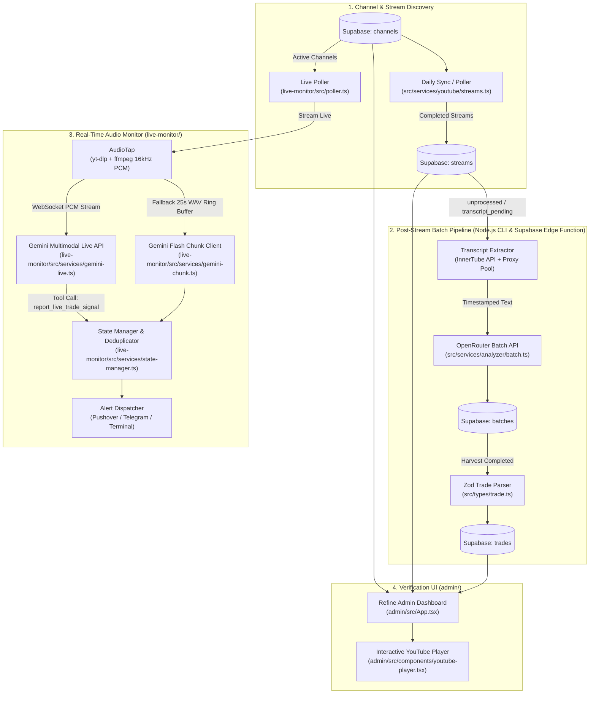

# YouTube Livestream Trade Analysis

[](https://github.com/umer2001/youtube-analysis/actions/workflows/deploy.yml)
[](https://github.com/umer2001/youtube-analysis/actions/workflows/deploy-to-dokku.yml)

An automated data pipeline, real-time audio monitor, and web dashboard that extracts, logs, and alerts on financial trades executed during YouTube livestreams for traders and market analysts.

## The Problem

Financial livestreamers broadcast multi-hour trading sessions across futures, forex, crypto, and equities, calling out entries, stop losses, and exits verbally without publishing structured trade logs. Auditing a streamer's historical win rate or following their setups in real time requires watching hours of video manually. Post-stream transcripts are often delayed or blocked by YouTube rate limits, while live broadcasts have no transcript until the stream ends.

## Why It Matters

Retail traders, prop-firm traders, and quantitative researchers who track live trading channels need verifiable records of what a streamer actually executed versus what they claimed. Converting raw broadcasts into timestamped trade records (`LONG`/`SHORT`, entry, exit, outcome) linked to exact video playback positions allows rapid verification, while live audio monitoring delivers trade alerts while the setup is still actionable.

- Streamers tracked and trades indexed to date: [ask: how many channels, livestreams, and extracted trades have you processed so far?]
- Real-time alert latency or batch cost savings observed in production: [ask: what end-to-end alert latency and per-stream analysis cost have you measured?]

## How It Works

The repository is organized into three deployable components sharing a Supabase PostgreSQL database:

1. **Post-Stream Batch Pipeline** ([`src/pipeline.ts`](src/pipeline.ts) and [`supabase/functions/daily-pipeline/index.ts`](supabase/functions/daily-pipeline/index.ts)): Discovers completed livestreams for tracked channels, fetches timestamped transcripts, submits asynchronous batch extraction jobs to OpenRouter, and persists structured trade records to Supabase. Scheduled daily at 00:00 UTC via `pg_cron` and `pg_net` ([`supabase/migrations/20261005121000_schedule_daily_pipeline.sql`](supabase/migrations/20261005121000_schedule_daily_pipeline.sql)).
2. **Real-Time Live Stream Monitor** ([`live-monitor/`](live-monitor) and [`src/services/live/`](src/services/live)): Polls active channels for live broadcasts, pipes live audio via `yt-dlp` and `ffmpeg` into the Google Gemini Multimodal Live API over WebSockets, deduplicates trade calls in memory, and dispatches alerts to Pushover, Telegram, and the terminal.
3. **Admin Dashboard** ([`admin/`](admin)): A React and Refine web interface for managing tracked channels, filtering extracted trades, and auditing sessions with an embedded YouTube player that seeks directly to extracted trade timestamps ([`admin/src/pages/streams/show.tsx`](admin/src/pages/streams/show.tsx)).



### Key Decisions

- **Chose HTML/redirect scraping of YouTube `/live` and `/streams` pages as a fallback (and primary live detector) over relying solely on YouTube Data API v3 `search.list`** ([`live-monitor/src/poller.ts`](live-monitor/src/poller.ts), [`src/services/youtube/streams.ts`](src/services/youtube/streams.ts)) because `search.list` consumes 100 quota units per request, which exhausts the default 10,000-unit daily quota when polling multiple channels every 60 seconds.
- **Chose OpenRouter Batch API with hex-encoded `custom_id` keys over synchronous LLM completions for post-stream transcripts** ([`src/services/analyzer/batch.ts`](src/services/analyzer/batch.ts), [`supabase/functions/_shared/openrouter.ts`](supabase/functions/_shared/openrouter.ts)) to process multi-hour transcripts asynchronously within a 24-hour completion window and satisfy downstream provider regex constraints (`^[a-z0-9_-]{1,64}$`) that reject uppercase characters in YouTube video IDs. [ask: confirm why you chose OpenRouter Batch over direct Gemini/OpenRouter synchronous calls for the daily pipeline]
- **Chose a 7-day `transcript_pending` retry window before marking streams `no_transcript`** ([`supabase/migrations/20261016000000_add_transcript_pending_status.sql`](supabase/migrations/20261016000000_add_transcript_pending_status.sql), [`src/services/pipeline/daily-sync.ts`](src/services/pipeline/daily-sync.ts)) because YouTube often delays auto-generated captions on newly ended livestreams by several hours or days.
- **Chose Gemini Multimodal Live WebSockets streaming 16kHz mono PCM audio (`yt-dlp` piped into `ffmpeg`) with a 25-second rolling WAV buffer fallback** ([`live-monitor/src/services/audio-tap.ts`](live-monitor/src/services/audio-tap.ts), [`live-monitor/src/services/gemini-live.ts`](live-monitor/src/services/gemini-live.ts), [`live-monitor/src/services/gemini-chunk.ts`](live-monitor/src/services/gemini-chunk.ts)) because active YouTube livestreams do not expose full caption tracks while broadcasting, requiring real-time audio inference and tool calling (`report_live_trade_signal`).
- **Chose a standalone Dockerized Node.js 22 Alpine service on Dokku for `live-monitor` alongside Supabase Edge Functions for `daily-pipeline`** ([`live-monitor/Dockerfile`](live-monitor/Dockerfile), [`supabase/functions/daily-pipeline/index.ts`](supabase/functions/daily-pipeline/index.ts)) because persistent WebSocket connections and child binaries (`yt-dlp`, `ffmpeg`) cannot run inside short-lived, memory-capped (150 MB) Deno Edge isolates. [ask: confirm why you separated `live-monitor` into a read-only Dokku service rather than writing live alerts to Supabase]

### Tech Stack

TypeScript, Node.js (v22), Deno (Supabase Edge Functions), PostgreSQL (Supabase, `pg_cron`, `pg_net`), React 19, Vite, Refine, Tailwind CSS, shadcn/ui, Google Gemini API (`@google/genai`), OpenRouter SDK (`@openrouter/sdk`), YouTube Data API v3 (`googleapis`), Zod, FFmpeg, yt-dlp, Docker, Dokku, Firebase Hosting, GitHub Actions.

### Tests

No tests yet (no automated unit or integration test runner is configured in `package.json`).

Manual verification tools included in the repository:
- Simulated and live audio alert harness ([`src/live-test.ts`](src/live-test.ts)):
  ```bash
  pnpm live-test --mock
  ```
- Edge Function transcript and proxy diagnostic mode ([`src/trigger-edge.ts`](src/trigger-edge.ts)):
  ```bash
  pnpm trigger-edge --debug-transcript --videoId HX3IEaRCeDE
  ```

### CI

Two GitHub Actions deployment workflows are configured in [`.github/workflows/`](.github/workflows):
- [`deploy.yml`](.github/workflows/deploy.yml): Runs on pushes to `main` and manual dispatch. Links the Supabase project, syncs secrets, pushes SQL migrations (`supabase db push`), deploys the `daily-pipeline` Supabase Edge Function, and builds and deploys the [`admin/`](admin) React dashboard to Firebase Hosting.
- [`deploy-to-dokku.yml`](.github/workflows/deploy-to-dokku.yml): Runs on pushes to `main` affecting `live-monitor/**` and manual dispatch. Builds [`live-monitor/Dockerfile`](live-monitor/Dockerfile), transfers the image over SSH to a Dokku host (`git:load-image`), syncs runtime environment variables, configures port `3000`, verifies `/health` over HTTP and HTTPS, and provisions Let's Encrypt TLS certificates.

## Live Demo

- Admin Dashboard & Live Monitor: [ask: live URL or video demo link] (If the deployment is private due to Supabase authentication and API costs, include a short screen recording showing the Refine dashboard seeking to trade timestamps in the YouTube player and a live Pushover/Telegram trade alert).

## How to Run It

### Prerequisites

- **Node.js** v20+ (v22 used in [`live-monitor/Dockerfile`](live-monitor/Dockerfile))
- **pnpm** v10.12.1 (`corepack enable && corepack prepare pnpm@10.12.1 --activate`)
- **Supabase CLI** v2+ (installed as a root devDependency for database migrations and Edge Functions)
- **FFmpeg** and **yt-dlp** on system `PATH` (required only for [`live-monitor`](live-monitor) and [`src/live-test.ts`](src/live-test.ts))

### Installation

```bash
# Install root CLI and batch pipeline dependencies
pnpm install

# Install admin dashboard dependencies
pnpm --dir admin install

# Install live-monitor service dependencies
pnpm --dir live-monitor install
```

### Environment Variables

Copy [`.env.example`](.env.example) to `.env` in the repository root, and [`live-monitor/.env.example`](live-monitor/.env.example) to `live-monitor/.env`:

| Variable | Component | Purpose |
| :--- | :--- | :--- |
| `GEMINI_API_KEY` | Root CLI, Edge Function, `live-monitor` | Google Gemini API key for video analysis and Multimodal Live audio streaming |
| `GEMINI_MODEL` | `live-monitor` | Gemini live model identifier (defaults to `gemini-3.8-live` in [`live-monitor/src/config.ts`](live-monitor/src/config.ts)) |
| `OPENROUTER_API_KEY` | Root CLI, Edge Function | OpenRouter API key for transcript analysis and Batch API submissions |
| `OPENROUTER_MODEL` | Root CLI | OpenRouter model for single-stream transcript fallback ([`src/services/analyzer/openrouter.ts`](src/services/analyzer/openrouter.ts)) |
| `OPENROUTER_BATCH_MODEL` | Root CLI, Edge Function | OpenRouter model used for batch jobs (e.g. `google/gemini-2.5-flash`) |
| `YOUTUBE_API_KEY` | Root CLI, Edge Function, `live-monitor` | Optional YouTube Data API v3 key; falls back to HTML scraping when omitted |
| `SUPABASE_URL` | Root CLI, Edge Function, `live-monitor` | Supabase project URL |
| `SUPABASE_ANON_KEY` | Root CLI | Supabase anonymous public key |
| `SUPABASE_SERVICE_ROLE_KEY` | Root CLI, Edge Function | Supabase service role key (required to bypass RLS when writing channels, streams, batches, and trades) |
| `SUPABASE_KEY` | `live-monitor` | Read-only key (`SUPABASE_ANON_KEY` or `SUPABASE_SERVICE_ROLE_KEY`) for querying active channels |
| `VITE_SUPABASE_URL` | `admin` | Supabase project URL for the React frontend ([`admin/src/providers/constants.ts`](admin/src/providers/constants.ts)) |
| `VITE_SUPABASE_ANON_KEY` | `admin` | Supabase anonymous key for the React frontend |
| `PUSHOVER_USER_KEY` | Root CLI, `live-monitor` | Optional Pushover user key for mobile/watch trade notifications |
| `PUSHOVER_APP_TOKEN` | Root CLI, `live-monitor` | Optional Pushover application token |
| `PUSHOVER_DEVICE` | Root CLI, `live-monitor` | Optional target device name for Pushover alerts |
| `PUSHOVER_EMERGENCY` | Root CLI, `live-monitor` | Set to `true` to trigger repeating priority-2 emergency alarms until acknowledged |
| `PUSHOVER_PRIORITY` | Root CLI, `live-monitor` | Pushover notification priority (`0`, `1`, or `2`) |
| `PUSHOVER_RETRY` | Root CLI | Seconds between repeating emergency alerts (minimum `30`) |
| `PUSHOVER_EXPIRE` | Root CLI | Seconds before unacknowledged emergency alerts expire (default `1800`) |
| `PUSHOVER_SOUND` | Root CLI, `live-monitor` | Optional custom Pushover notification sound |
| `TELEGRAM_BOT_TOKEN` | Root CLI, `live-monitor` | Optional Telegram Bot token for trade alerts |
| `TELEGRAM_CHAT_ID` | Root CLI, `live-monitor` | Optional Telegram destination chat or channel ID |
| `POLL_INTERVAL_SECONDS` | `live-monitor` | Seconds between live broadcast checks for active channels (default `60`) |
| `MAX_CONCURRENT_STREAMS` | `live-monitor` | Maximum simultaneous livestreams monitored by worker pool (default `3`) |
| `YOUTUBE_COOKIES` / `COOKIES_FILE` | `live-monitor` | Optional Netscape-format cookies (or Base64 string) to pass to `yt-dlp` |
| `DEBOUNCE_MINUTES` | `live-monitor` | Window in minutes to suppress duplicate alerts on the same symbol (default `15`) |
| `VERBOSE` | `live-monitor` | Set to `true` for verbose audio tap and chunk logging |
| `WEBSHARE_PROXIES` | Edge Function | Optional comma-separated proxy URLs for YouTube InnerTube transcript fetching ([`supabase/functions/_shared/transcript.ts`](supabase/functions/_shared/transcript.ts)) |

### Commands

**1. Manage Tracked Channels ([`src/manage-channels.ts`](src/manage-channels.ts))**
```bash
# Add a YouTube channel by handle or URL
pnpm manage-channels --add https://www.youtube.com/@TradeLikeMalika

# List active tracked channels
pnpm manage-channels --list

# Refresh channel metadata (title, channel_id, thumbnail)
pnpm manage-channels --refresh
```

**2. Run the Post-Stream Pipeline ([`src/pipeline.ts`](src/pipeline.ts))**
```bash
# Run full cycle locally: sync channels -> submit transcript batch -> harvest trades
pnpm pipeline --all

# Run individual stages
pnpm pipeline --sync
pnpm pipeline --submit --max-batch 15
pnpm pipeline --harvest

# Or trigger the deployed Supabase Edge Function remotely
pnpm trigger-edge --all --limit 4
```

**3. Single-Video & Batch CLI Utilities ([`src/index.ts`](src/index.ts), [`src/list-streams.ts`](src/list-streams.ts), [`src/batch-process.ts`](src/batch-process.ts))**
```bash
# Analyze a single YouTube video (Gemini video primary, OpenRouter transcript fallback)
pnpm start https://www.youtube.com/watch?v=XEtkxYOvnHo

# List recent completed livestreams for a channel
pnpm list-streams https://www.youtube.com/@TradeLikeMalika

# Interactive CLI for submitting and checking OpenRouter batches
pnpm batch-process
```

**4. Run the Real-Time Live Monitor ([`live-monitor/src/index.ts`](live-monitor/src/index.ts), [`src/live-test.ts`](src/live-test.ts))**
```bash
# Run the live-monitor daemon in development
pnpm --dir live-monitor start

# Build and run the production bundle
pnpm --dir live-monitor build
pnpm --dir live-monitor serve

# Test live audio extraction on a specific URL or mock sequence from root
pnpm live-test --mock
pnpm live-test --url "https://www.youtube.com/watch?v=VIDEO_ID" --pushover
```

**5. Run the Admin Dashboard ([`admin/package.json`](admin/package.json))**
```bash
# Start local development server
pnpm --dir admin dev

# Type-check and build production bundle
pnpm --dir admin build
```

## What's Next

- **Consolidate duplicated services into a shared workspace package**: Live audio capture, Gemini Live clients, state management, and notification channels are currently duplicated between [`src/services/`](src/services) and [`live-monitor/src/services/`](live-monitor/src/services), and Edge Function helpers are duplicated between [`supabase/functions/_shared/`](supabase/functions/_shared) and [`supabase/functions/daily-pipeline/_shared/`](supabase/functions/daily-pipeline/_shared).
- **Persist real-time live trade alerts to Supabase**: Implement the `public.alerts` table migration and database writer described in [`docs/realtime-live-trade-alert-system-plan.md`](docs/realtime-live-trade-alert-system-plan.md); currently [`live-monitor`](live-monitor/src/db.ts) runs in read-only mode and stores active trade state only in memory.
- **Decouple transcript scraping from Edge Function memory limits**: The [`daily-pipeline`](supabase/functions/daily-pipeline/index.ts) Edge Function currently processes at most 4 streams per invocation (`limit = 4`) to stay under Supabase's 150 MB Deno isolate limit (HTTP 546).

## License

[ISC](LICENSE)

