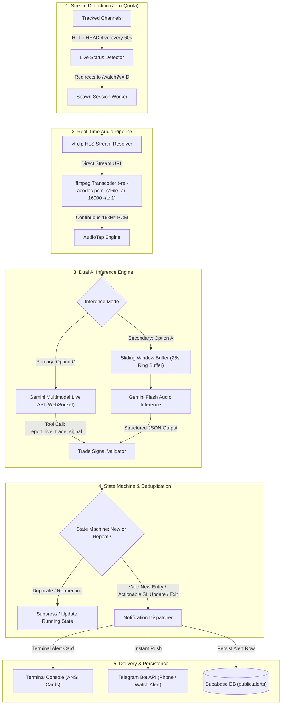

# Real-Time YouTube Livestream Trade Setup & Alert System

## 1. Executive Summary & Vision

The objective of this system is to transition from **post-stream batch analysis** to **real-time live stream monitoring**, alerting the user via **instant push notification (e.g., Telegram / Discord / FCM)** within **sub-minute latency** of a trading streamer announcing, planning, or executing a live trade setup.

### Core Targets
* **End-to-End Alert Latency**: Sub-30s from spoken call to push notification.
* **Extraction Quality**: High-fidelity detection of Asset/Ticker, Direction (`LONG`/`SHORT`), Entry Price, Stop Loss, Take Profit, and Context/Rationale.
* **Dual Inference Architecture**:
  * **Primary (Option C)**: Gemini Multimodal Live API (`ai.live.connect` via WebSockets) with real-time PCM audio streaming and sub-second tool execution.
  * **Secondary / Fallback (Option A)**: Sliding rolling audio chunks (20-25s window evaluated every 10-12s) to Gemini Flash (`ai.models.generateContent`).
* **Deduplication**: Intelligent session state tracking to prevent repeated alert spam for the same floating position.
* **Zero YouTube API Quota Usage**: HTTP redirect probing against channel `/live` endpoints to eliminate API quota exhaustion.

---

## 2. High-Level Architecture & Data Flow



---

## 3. Core Component Architecture

### Component 1: Zero-Quota Live Status Detector
* **Problem**: Calling YouTube Data API `search.list(eventType=live)` costs **100 quota units per call**. Polling 4 channels every 60s costs 24,000 units/hr, depleting the 10,000 daily quota in 25 minutes.
* **Mechanism**:
  * Probes `https://www.youtube.com/@ChannelHandle/live` using lightweight HTTP `HEAD` / `GET` requests with redirect following.
  * If offline: redirects to channel home or returns 404 / canonical video page.
  * If live: redirects to `https://www.youtube.com/watch?v={LIVE_VIDEO_ID}` (Status 303/200).
  * **Cost: 0 YouTube Data API quota units**.

### Component 2: Audio Stream Ingestion (`src/services/live/audio-tap.ts`)
* **Binary Discovery**: Automatically resolves `yt-dlp` and `ffmpeg` in system `PATH` and WinGet installation directories (`LOCALAPPDATA\Microsoft\WinGet\Packages`).
* **Stream Resolution**: Uses `yt-dlp -g -f bestaudio/best <URL>` to extract the raw live HLS stream URL.
* **PCM Streaming**: Spawns `ffmpeg -re -i <STREAM_URL> -vn -acodec pcm_s16le -ar 16000 -ac 1 -f s16le -`.
* **Output**: Streams raw 16kHz 16-bit mono PCM bytes (32,000 bytes/sec) directly into memory pipes.

### Component 3: Dual AI Inference Engine

#### Primary: Option C (Gemini Multimodal Live WebSocket API)
* **Client**: `src/services/live/gemini-live-client.ts`
* **Model**: `gemini-3.1-flash-live-preview` or `gemini-3.8-live`.
* **Interface**: `ai.live.connect` with bidirectional audio streaming.
* **Mechanism**:
  * Pushes real-time PCM audio slices (`32,000 bytes` / ~1s) via `session.sendRealtimeInput({ media: { mimeType: 'audio/pcm;rate=16000', data } })`.
  * Configures structured function declaration `report_live_trade_signal`.
  * When Gemini hears an entry, SL modification, or exit, it calls `report_live_trade_signal` in real-time.
  * The client acknowledges the tool call immediately to keep the connection streaming without pause.

#### Secondary / Fallback: Option A (Rolling Audio Chunks)
* **Client**: `src/services/live/gemini-chunk-client.ts`
* **Model**: `gemini-3.8-flash`.
* **Mechanism**:
  * Maintains a rolling ring buffer of 20–25 seconds of audio.
  * Every 10–12 seconds, wraps the buffer in a valid 44-byte WAV header in-memory and dispatches to `ai.models.generateContent`.
  * Injects rolling session context notes to prevent "naked entry" detection loss when the asset symbol was spoken in an earlier chunk.

### Component 4: State Machine & Deduplication (`src/services/live/state-manager.ts`)
* **State Store**: Tracks active trades per symbol (`activeTrades = Map<symbol, ActiveTradeState>`).
* **Debounce Rules**:
  1. **New Setup**: If no trade exists for symbol in the last 15 minutes, emits `NEW` trade alert.
  2. **Active Position Chatter**: If the streamer is reiterating the same trade with matching direction and parameters, marks `SUPPRESSED`.
  3. **Trade Modification**: If SL/TP is adjusted (e.g. "Move stop loss to breakeven"), emits `UPDATE` alert.
  4. **Exit**: If streamer says "Closed position" or "Took profit", emits `EXIT` alert and removes from active map.

### Component 5: Dispatcher & Delivery (`src/services/notifications/alert-dispatcher.ts`)
* **Multi-Channel Adapter Pattern**: Decoupled, extensible channel architecture (`NotificationChannel` interface) executing concurrent dispatch with `Promise.allSettled()`.
* **Terminal**: High-contrast ANSI-formatted cards with side colors (Green for LONG, Red for SHORT), metrics, rationale, and quote.
* **Pushover** (`pushover-channel.ts`): Sub-second native push alerts directly to iOS, Android, Apple Watch, and Desktop:
  * Dynamic sound effects: `'cashregister'` on profit/exit, `'incoming'` on entry, `'intermission'` on adjustments.
  * Priority mapping: Priority `1` (High, bypasses do-not-disturb/quiet hours) on live entries & exits; Priority `0` on minor updates.
  * Direct stream links and rich HTML formatting.
* **Telegram** (`telegram-channel.ts`): Push notifications via Telegram Bot API using `TELEGRAM_BOT_TOKEN` & `TELEGRAM_CHAT_ID`.

---

## 4. CLI Test Runner (`src/live-test.ts`)

The system includes a dedicated CLI test tool enabling testing on **active live streams, recorded trading videos, or simulated mock streams**.

### Command Syntax
```bash
pnpm live-test --url <YOUTUBE_URL> [options]
```

### Options
* `--url, -u`: YouTube livestream URL or recorded video watch URL.
* `--mic`: Capture audio directly from your microphone (live testing).
* `--file, -f`: Stream from a local audio file (.wav, .mp3, .m4a).
* `--mode, -m`: Inference mode: `live` (Option C, default) or `chunk` (Option A).
* `--model`: Override the default Gemini model name.
* `--pushover, -p`: Send instant push alerts to phone/watch via Pushover (`PUSHOVER_USER_KEY` & `PUSHOVER_APP_TOKEN`).
* `--telegram, -t`: Dispatch alerts to Telegram in addition to terminal output.
* `--verbose, -v`: Print verbose ffmpeg and streaming buffer metrics.
* `--duration, -d`: Maximum test run duration in seconds.
* `--mock`: Run an immediate simulated trade detection sequence to verify formatting and state deduplication without YouTube.

### Example Runs
```bash
# Test simulated alert sequence
pnpm live-test --mock

# Test with your microphone and send alerts to your phone via Pushover
pnpm live-test --mic --pushover

# Test with Gemini Multimodal Live API on YouTube stream
pnpm live-test --url "https://www.youtube.com/watch?v=EXAMPLE_ID" --pushover
```

---

## 5. Database Schema Extensions (`public.alerts`)

```sql
-- Migration: 20261007160000_create_realtime_alerts_table.sql

CREATE TABLE IF NOT EXISTS public.alerts (
    id UUID PRIMARY KEY DEFAULT gen_random_uuid(),
    stream_id UUID REFERENCES public.streams(id) ON DELETE CASCADE,
    channel_id UUID NOT NULL REFERENCES public.channels(id) ON DELETE CASCADE,
    symbol TEXT NOT NULL,
    side TEXT CHECK (side IN ('LONG', 'SHORT')),
    entry_price TEXT,
    stop_loss TEXT,
    take_profit TEXT,
    trade_type TEXT NOT NULL DEFAULT 'NEW_ENTRY' CHECK (trade_type IN ('NEW_ENTRY', 'PENDING_ORDER', 'SL_TP_UPDATE', 'EXIT', 'NONE')),
    confidence TEXT NOT NULL DEFAULT 'HIGH' CHECK (confidence IN ('HIGH', 'MEDIUM', 'LOW')),
    rationale TEXT,
    verbatim_quote TEXT,
    stream_timestamp TEXT,
    notification_sent BOOLEAN NOT NULL DEFAULT false,
    notification_channel TEXT NOT NULL DEFAULT 'telegram',
    idempotency_key TEXT UNIQUE,
    raw_payload JSONB,
    created_at TIMESTAMPTZ NOT NULL DEFAULT timezone('utc'::text, now())
);

ALTER TABLE public.alerts ENABLE ROW LEVEL SECURITY;

CREATE POLICY "Allow authenticated read alerts"
    ON public.alerts FOR SELECT TO authenticated USING (true);

CREATE POLICY "Allow service role manage alerts"
    ON public.alerts FOR ALL USING (auth.role() = 'service_role');

CREATE INDEX IF NOT EXISTS idx_alerts_stream_id ON public.alerts(stream_id);
CREATE INDEX IF NOT EXISTS idx_alerts_channel_id ON public.alerts(channel_id);
CREATE INDEX IF NOT EXISTS idx_alerts_created_at ON public.alerts(created_at DESC);
```
