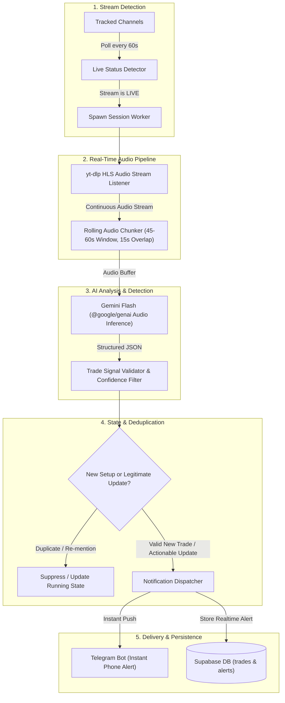

# Real-Time YouTube Livestream Trade Setup & Alert System

## 1. Executive Summary & Vision

The objective of this system is to transition from **post-stream batch analysis** to **real-time live stream monitoring**, alerting the user via **instant push notification (e.g., Telegram / Discord)** within **15 to 30 seconds** of a trading streamer announcing, planning, or executing a live trade setup.

### Core Targets
* **End-to-End Alert Latency**: ≤ 30 seconds from spoken call to phone notification.
* **Extraction Quality**: High-fidelity detection of Asset/Ticker, Direction (`LONG`/`SHORT`), Entry Price, Stop Loss, Take Profit, and Context/Rationale.
* **Deduplication**: Intelligent session state tracking to prevent repeated alert spam for the same trade.
* **Cost Efficiency**: ≤ $0.15 in AI inference per 3-hour live streaming session.

---

## 2. High-Level Architecture & Data Flow



---

## 3. Detailed Component Architecture

### Component 1: Live Status Poller (`src/services/live/stream-detector.ts`)
* **Purpose**: Detect when tracked channels start streaming without exhausting YouTube API quotas.
* **Mechanism**:
  * Lightweight check against YouTube's live channel endpoints (`https://www.youtube.com/@ChannelName/live`) or YouTube Data API `search.list(eventType=live)`.
  * Scheduled to run every 60 seconds during the channels' known active hours:
    * **Trade Like Malika**: Weekdays, 07:30 – 11:30 UTC.
    * **ICT ENIGMA**: Weekends & Friday, 11:00 – 18:00 UTC.
    * **Booming Bulls**: Weekdays, 12:00 – 16:30 UTC.
    * **Umar Punjabi Live**: Weekdays, 12:30 – 15:30 UTC.

### Component 2: Audio Stream Ingestion (`src/services/live/audio-tap.ts`)
* **Why Audio Instead of Video**:
  * Video processing (OCR / frame extraction) is compute-heavy, bandwidth-intensive, and introduces multi-minute latencies.
  * Streamers always **speak their intent aloud** before or as they execute (*"Taking a short at 4185, stop above high at 4188"*).
* **Implementation**:
  * Uses `yt-dlp` to resolve the live HLS stream URL (`.m3u8`).
  * Pipes the live audio track via `ffmpeg` into sliding memory buffers:
    * **Chunk Duration**: 45 to 60 seconds.
    * **Overlap**: 15 seconds (ensures trade calls that span a boundary are never chopped in half).

### Component 3: Low-Latency AI Extraction (`src/services/live/audio-analyzer.ts`)
* **Engine**: Google Gemini 2.0 / 1.5 Flash (`@google/genai`).
* **Input**: Native raw audio chunks (`audio/mp3` or `audio/wav`).
* **Prompt Strategy**: Low-latency, strict JSON schema output.
* **Schema Contract**:
  ```typescript
  interface LiveTradeDetectionResult {
    has_trade_action: boolean; // true if an entry, planned order, or exit occurred
    trade_type: "NEW_ENTRY" | "PENDING_ORDER" | "SL_TP_UPDATE" | "EXIT" | "NONE";
    symbol: string | null;      // e.g. "XAUUSD", "BTC", "NQ"
    side: "LONG" | "SHORT" | null;
    entry_price: string | null;
    stop_loss: string | null;
    take_profit: string | null;
    risk_reward: string | null;
    rationale: string | null;
    confidence: "HIGH" | "MEDIUM" | "LOW";
    verbatim_quote: string | null;
  }
  ```
* **Guardrails**:
  * Explicit instructions to ignore past recap commentary (*"Yesterday I took..."*) or hypothetical thoughts (*"If it drops 500 points maybe next week..."*).
  * Only triggers if `has_trade_action === true` and `confidence !== 'LOW'`.

### Component 4: Deduplication & Session State Engine (`src/services/live/state-manager.ts`)
* Streamers frequently talk about an open trade for 10–20 minutes while it floats.
* **Deduplication Rules**:
  1. Maintain an in-memory session cache: `active_trades = Map<symbol, LastKnownTrade>`.
  2. If a new detection matches the active symbol and direction within a **15-minute sliding window**, compare parameters:
     * If entry, SL, and TP are unchanged: **Suppress notification**.
     * If the streamer announces *"Moving SL to breakeven/cost"* or *"Booking 50% partial profit"*: Dispatch a **"Trade Update"** alert rather than a new trade alert.
  3. Evict trades when an explicit `EXIT` action is detected or after 60 minutes without update.

### Component 5: Instant Notification Engine (`src/services/notifications/telegram.ts`)
* **Provider**: Telegram Bot API (`https://api.telegram.org/bot<TOKEN>/sendMessage`).
* **Why Telegram**:
  * Zero cost, 100% delivery reliability, sub-second delivery to mobile devices and smartwatches.
  * Native Markdown formatting, action buttons, and direct link preview.
* **Notification Template**:
  ```markdown
  🚨 *LIVE TRADE ALERT*
  ━━━━━━━━━━━━━━━━━━━━━
  👤 *Trader*: Trade Like Malika
  🎯 *Asset*: Gold (XAUUSD)
  📉 *Action*: *SHORT*
  📍 *Entry*: `~4185.50`
  🛑 *Stop Loss*: `4188.00` (~25 pips)
  🎯 *Take Profit*: `4175.00` (~105 pips)
  ⚖️ *R:R*: `1 : 4.2`
  ━━━━━━━━━━━━━━━━━━━━━
  💡 *Setup*: "Retest of broken support zone after sweep of day high"
  ⏱️ *Stream Time*: ~01:17:15
  🔗 [Watch Live Stream Now](https://youtube.com/watch?v=VIDEO_ID)
  ```

---

## 4. Database Schema Extensions

To store and audit real-time alerts alongside historical batch data, extend Supabase with an `alerts` table:

```sql
-- Migration: YYYYMMDDHHMMSS_create_realtime_alerts_table.sql

CREATE TABLE IF NOT EXISTS public.alerts (
    id UUID PRIMARY KEY DEFAULT gen_random_uuid(),
    stream_id UUID REFERENCES public.streams(id) ON DELETE CASCADE,
    channel_id UUID NOT NULL REFERENCES public.channels(id) ON DELETE CASCADE,
    symbol TEXT NOT NULL,
    side TEXT NOT NULL CHECK (side IN ('LONG', 'SHORT')),
    entry_price TEXT,
    stop_loss TEXT,
    take_profit TEXT,
    trade_type TEXT NOT NULL DEFAULT 'NEW_ENTRY',
    confidence TEXT NOT NULL DEFAULT 'HIGH',
    rationale TEXT,
    notification_sent BOOLEAN NOT NULL DEFAULT false,
    notification_channel TEXT NOT NULL DEFAULT 'telegram',
    raw_payload JSONB,
    created_at TIMESTAMPTZ NOT NULL DEFAULT timezone('utc'::text, now())
);

CREATE INDEX IF NOT EXISTS idx_alerts_stream_id ON public.alerts(stream_id);
CREATE INDEX IF NOT EXISTS idx_alerts_channel_id ON public.alerts(channel_id);
CREATE INDEX IF NOT EXISTS idx_alerts_created_at ON public.alerts(created_at DESC);
```

---

## 5. Phased Implementation Roadmap

### Phase 1: Notification Channel & Dispatcher
* **Files**: `src/services/notifications/telegram.ts`, `src/types/alert.ts`
* **Deliverables**:
  * Create Telegram bot and establish chat binding via `.env` (`TELEGRAM_BOT_TOKEN`, `TELEGRAM_CHAT_ID`).
  * Implement formatted alert messenger with test harness (`pnpm test-alert`).

### Phase 2: Live Stream Detection Service
* **Files**: `src/services/live/stream-detector.ts`
* **Deliverables**:
  * Poll tracked channels in Supabase for `live` status.
  * Update `streams` table row status to `stream_status = 'live'` upon discovery.
  * Emit start/stop stream events.

### Phase 3: Live Audio Tap & Rolling Chunker
* **Files**: `src/services/live/audio-tap.ts`
* **Deliverables**:
  * Integrate `yt-dlp` executable wrapper to obtain the live HLS `.m3u8` playlist.
  * Implement 60-second rolling audio chunk generator using `ffmpeg` stdout streaming into memory buffer.

### Phase 4: Gemini Flash Audio Analysis Engine
* **Files**: `src/services/analyzer/live-audio-analyzer.ts`
* **Deliverables**:
  * Direct `@google/genai` Gemini Flash integration with audio buffer payload.
  * Structured schema enforcement and validation.
  * Confidence scoring and noise rejection.

### Phase 5: State Tracking, Deduplication & Orchestration
* **Files**: `src/services/live/state-manager.ts`, `src/live-monitor.ts`
* **Deliverables**:
  * In-memory session state machine for active trades.
  * Tie detector, audio tap, analyzer, state manager, and Telegram dispatcher together into a single daemon command (`pnpm live-monitor`).
  * Write recorded alerts directly into Supabase `alerts` and `trades` tables.

---

## 6. Resource Requirements & Operational Cost

| Item | Requirement / Metric | Cost |
| :--- | :--- | :--- |
| **Compute** | 1 CPU core, 512 MB – 1 GB RAM (Local or VPS) | Free locally, or ~$4–$5/mo VPS |
| **YouTube Ingestion** | `yt-dlp` + `ffmpeg` (audio-only stream, ~64kbps) | Negligible bandwidth (~28 MB/hour) |
| **AI Inference** | Gemini 2.0 Flash Audio (~60 calls/hr @ ~$0.0007/call) | **~$0.04 to $0.05 per hour** |
| **Push Notifications** | Telegram Bot API | **100% Free** |
| **Monthly Estimate** | 4 streamers × 2 hours/day × 20 days/month | **~$6.50 – $8.00 / month total** |

---

## 7. Failure Modes & Edge Case Handling

1. **Stream Buffer Disconnect / Reconnection**:
   * If `yt-dlp` loses connection during a stream hiccup, automatically retry with exponential backoff (up to 3 retries over 30s) before terminating the worker.
2. **Trader Speaks in Mixed Languages (Hindi / Urdu / English)**:
   * Channels like Booming Bulls and Trade Like Malika frequently use code-switching (*"Ye level break hua to sell karenge, stop loss candle high pe"*).
   * Gemini 2.0/1.5 Flash natively understands multilingual Hindi, Urdu, and English financial slang (`stop loss`, `target`, `entry`, `break-even`, `point`, `pips`).
3. **Hypothetical Scenarios vs Real Trades**:
   * Explicit prompt constraint: The trader must be committing to an active entry, setting an active limit/stop order, or giving a clear signal to viewers.
   * If the trader says *"Agar ye upar gaya to kal dekhenge"* (If it goes up we'll see tomorrow), classify as `has_trade_action = false`.
